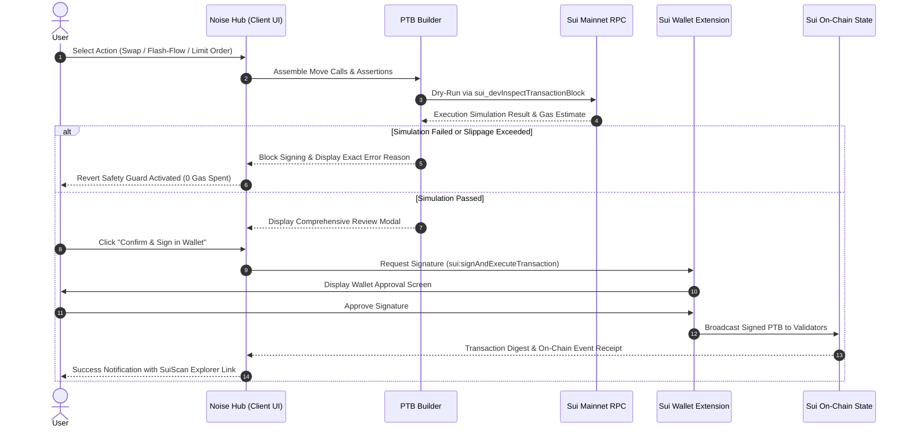

<div align="center">

# ⚡ NOISE HUB
### Non-Custodial Sui Action Hub, Flash-Flow Studio & DeepBook v3 Pro Terminal

[](https://sui.io)
[](https://noisesui.vercel.app)
[](docs/SECURITY-MODEL.md)
[](https://deepbook.tech)
[](docs/INTEGRATIONS.md)
[](#-zero-server-quick-start--how-it-works-without-a-backend)

**Sui DeFi without the noise.** A single, non-custodial execution surface connecting **21 Sui protocols**, featuring 1-click atomic multi-protocol transaction blocks (PTBs), live DeepBook v3 CLOB orderbooks with interactive candlestick charting, an automated AI strategy scheduler, and cross-chain bridge routing.

[🚀 Launch Live Terminal](https://noisesui.vercel.app/app) · [🌐 Main Portal](https://noisesui.vercel.app) · [📖 System Architecture](docs/ARCHITECTURE.md) · [🛡️ Security Model](docs/SECURITY-MODEL.md)

</div>

---

## 📑 Table of Contents

- [Overview & The Sui Advantage](#-overview--the-sui-advantage)
- [Zero-Server Quick Start (Run in 5 Seconds Without a Server)](#-zero-server-quick-start--how-it-works-without-a-backend)
- [Core Terminal Modules](#-core-terminal-modules)
  - [1. ⚡ Flash-Flow Studio (Atomic PTB Pipeline)](#1--flash-flow-studio-atomic-ptb-pipeline)
  - [2. 📊 DeepBook v3 Pro CLOB & Predict Range Markets](#2--deepbook-v3-pro-clob--predict-range-markets)
  - [3. 🤖 Noise AutoPilot & AI Strategy Studio](#3--noise-autopilot--ai-strategy-studio)
  - [4. 💼 Unified Portfolio & 21-Protocol Earn Matrix](#4--unified-portfolio--21-protocol-earn-matrix)
  - [5. 🌉 Cross-Chain Bridge Gateway](#5--cross-chain-bridge-gateway)
- [How It Works: Zero-Server Client-First Architecture](#-how-it-works-zero-server-client-first-architecture)
- [Transaction Lifecycle (Atomic Review & Revert Guarantee)](#-transaction-lifecycle)
- [Verified 21-Protocol Ecosystem Matrix](#-verified-21-protocol-ecosystem-matrix)
- [Project Directory Structure](#-project-directory-structure)
- [Non-Custodial Security & Integrity](#-non-custodial-security--integrity)
- [Contributing & Verification](#-contributing--verification)

---

## 🌟 Overview & The Sui Advantage

In traditional DeFi, users navigate a fragmented maze of decentralized applications: opening tabs for **Cetus** to swap, **NAVI** or **Suilend** to manage loans, **SpringSui** or **Aftermath** to stake, **DeepBook** to trade orderbooks, and external bridges to move assets.

**Noise Hub unites the entire Sui ecosystem into a single unified terminal powered by Sui's Programmable Transaction Blocks (PTB).**

### Why Sui Programmable Transaction Blocks (PTB)?
- **Atomic Composability:** Chain up to **1,024 Move calls** into a single transaction block.
- **Zero-Loss Revert Guarantee:** Either every step in the pipeline succeeds, or the entire block aborts on-chain. Your assets never get stuck midway.
- **Sub-Second Finality & Minimal Gas:** Typical complex 4-step PTB loops execute in ~400ms for under **0.003 SUI** in total gas.
- **100% Non-Custodial:** Private keys never leave your browser wallet. The hub only constructs unsigned transaction bytes for your explicit review and signature.

---

## ⚡ Zero-Server Quick Start — How It Works Without a Backend

**Noise Hub is engineered as a client-first, zero-server architecture.** You do **NOT** need to lift a Node server, compile backend code, or configure a database to run, explore, and use the application locally.

All blockchain data reads, wallet signing, and PTB simulations communicate **directly with the Sui Mainnet RPC** from your browser!

### Option A: Instant Local Preview (Zero Install)
Using Python's built-in web server:
```bash
# Clone the repository
git clone https://github.com/Juniorj87/noise.git
cd noise

# Start a local static server on port 3000
python -m http.server 3000
```
Open **[http://localhost:3000/app.html](http://localhost:3000/app.html)** in your browser.

### Option B: Node.js (One-Line Runner)
```bash
npx serve . -p 3000
```
Open **[http://localhost:3000/app.html](http://localhost:3000/app.html)**.

### Option C: Direct File Opening
You can even open `app.html` directly in any modern browser with a Sui Wallet extension installed!

> [!NOTE]
> The `api/` directory contains optional Vercel Serverless lambda functions (used for serverless price caching, CoinGecko proxying, and global rankings). The core frontend (`app.html`), DeepBook charts, PTB builders, Wallet Standard module, and Sui RPC dry-runs function independently without a running server daemon.

---

## 🚀 Core Terminal Modules

### 1. ⚡ Flash-Flow Studio (Atomic PTB Pipeline)
The flagship killer feature of Noise Hub. Execute advanced multi-protocol DeFi strategies in **1 single wallet signature**:

- **🚀 Leveraged Staking Loop:** Stakes SUI into `sSUI` (SpringSui) ➔ deposits collateral into NAVI ➔ borrows USDC ➔ swaps back to SUI via DeepBook v3 CLOB ➔ restakes into `sSUI` for boosted net yields up to **+18.42% APY**.
- **🔄 Debt Migration & Relocate:** Move collateral and debt between Scallop, NAVI, and Suilend in a single atomic block with **$0 cash required upfront** (zero liquidation gap).
- **⚡ DeepBook <-> Cetus Arbitrage:** Captures immediate price discrepancies between Cetus CLMM pools and DeepBook v3 orderbooks. Move assertions ensure the transaction automatically reverts if net profit does not exceed network fees.
- **🛡️ Delta-Neutral Staking Shield:** Deposits SUI into liquid-staked `afSUI` while opening an offsetting hedge position to capture pure staking yield with zero directional volatility.
- **Move Dry-Run Modal:** Visualizes the full breakdown of PTB operations (`SplitCoins`, `MoveCall`, `TransferObjects`, `SlippageAssertion`) with simulated gas estimation before signing.

---

### 2. 📊 DeepBook v3 Pro CLOB & Predict Range Markets
Institutional-grade trading interface for Sui’s central limit order book:

- **Dual-Mode Chart Engine:**
  - **Native High-Performance Canvas:** Proprietary HTML5 Canvas candlestick and volume chart with smooth hover crosshairs, 24h dynamic timeframes (1m, 5m, 15m, 1H, 4H, 1D), and 9-period & 21-period Exponential Moving Averages (EMA).
  - **TradingView Pro Switch:** One-click toggle to TradingView Pro charting with advanced indicators, drawings, and technical overlays.
- **Live Orderbook Ladder:** Real-time L2 orderbook feeds with proportional green/red liquidity depth bars and clickable prices for instant limit order entry.
- **24h Ticker Statistics Ribbon:** Real-time High, Low, 24h Volume, Maker rebate indicator (**0.00% maker fees**), and live RPC status.
- **DeepBook Predict (Binary Expiry Range Markets):**
  - Trade fixed-payout range markets settling at **$1.00 USDC** per winning contract.
  - Live expiry countdown timer, real-time quote redemption, and 1-click position claiming.

---

### 3. 🤖 Noise AutoPilot & AI Strategy Studio
Automated DeFi operations powered by natural language intent recognition:

- **Interactive Weekly Schedule Timetable:** Visual calendar (Monday through Sunday) highlighting scheduled executions and today’s active routines.
- **Natural Language Intent Parser:** Type natural requests such as:
  > *"Swap 50 SUI to USDC every Monday at 09:00 UTC"*  
  > *"Monitor my NAVI loan and trigger auto-repay if Health Factor drops below 1.25"*  
  The AI engine parses the schedule, protocol target, amounts, and slippage guards directly into an active task card.
- **Pre-Configured Automation Blueprints:** 1-click setup for Weekly DCA, Lending Sentinel, Yield Auto-Compounder, and DeepBook Dip Sniper.
- **Bring-Your-Own-Key (BYOK) Security:** Connect your personal OpenAI, DeepSeek, Claude, or local Ollama endpoint. API keys are kept strictly in browser `localStorage` and are never logged or transmitted to our servers.

---

### 4. 💼 Unified Portfolio & 21-Protocol Earn Matrix
- **Cross-Protocol Capital Aggregate:** Consolidates native SUI, stablecoins, LP positions, staking derivatives (`sSUI`, `afSUI`, `vSUI`, `haSUI`), and lending balances.
- **Demo Mode:** New users can evaluate the full terminal interface with sample balances ($24,430 portfolio) before connecting a wallet.
- **Comprehensive Earn Hub:** Real-time live APYs across 21 protocols with instant search filtering by asset or yield strategy.

---

### 5. 🌉 Cross-Chain Bridge Gateway
- Powered by Wormhole Connect.
- Dynamic route calculations with estimated transfer times (Ethereum ~12-15m, Solana ~2-4m, Arbitrum ~4-6m, Sui Native ~3m) and real-time gas fee estimates.

---

## 🏛️ How It Works: Zero-Server Client-First Architecture

Noise Hub is intentionally decoupled from traditional backend servers. The diagrams below illustrate the system design:

```
┌─────────────────────────────────────────────────────────────────────────────┐
│                             USER BROWSER / CLIENT                           │
│                                                                             │
│   ┌─────────────────┐   ┌──────────────────────┐   ┌────────────────────┐   │
│   │   app.html UI   │   │  Native Chart Engine │   │ AutoPilot Planner  │   │
│   │ (Tailwind-free) │   │ (HTML5 Canvas + TV)  │   │ (Local Strategy)   │   │
│   └────────┬────────┘   └──────────┬───────────┘   └─────────┬──────────┘   │
│            │                       │                         │              │
│            ▼                       ▼                         ▼              │
│   ┌─────────────────────────────────────────────────────────────────────┐   │
│   │                 Hub Transaction & PTB Builder Engine                │   │
│   │     • Chains SplitCoins, MoveCalls, and Slippage Assertions         │   │
│   └──────────────────────────────────┬──────────────────────────────────┘   │
│                                      │                                      │
│                                      ▼                                      │
│   ┌─────────────────────────────────────────────────────────────────────┐   │
│   │            Wallet Standard Module (@wallet-standard/app)            │   │
│   │        Slush · Suiet · Phantom · Nightly · OKX · Sui Wallet         │   │
│   └──────────────────────────────────┬──────────────────────────────────┘   │
└──────────────────────────────────────┼──────────────────────────────────────┘
                                       │
            Direct JSON-RPC Requests   │   Signed Transaction Broadcast
           (devInspect & Live State)   │   (User signs locally)
                                       ▼
┌─────────────────────────────────────────────────────────────────────────────┐
│                          SUI MAINNET BLOCKCHAIN                             │
│                                                                             │
│   ┌───────────────────┐  ┌───────────────────┐  ┌───────────────────────┐   │
│   │   DeepBook v3     │  │   Cetus CLMM      │  │   NAVI / Suilend      │   │
│   │ (CLOB Orderbooks) │  │  (Aggregator Swap)│  │ (Lending & Borrowing) │   │
│   └───────────────────┘  └───────────────────┘  └───────────────────────┘   │
│   ┌───────────────────┐  ┌───────────────────┐  ┌───────────────────────┐   │
│   │   SpringSui / afSUI│ │   Scallop Protocol│  │   Wormhole Bridge     │   │
│   │ (Liquid Staking)  │  │(Collateral Pools) │  │  (Cross-Chain Relay)  │   │
│   └───────────────────┘  └───────────────────┘  └───────────────────────┘   │
│                                                                             │
│               [ ATOMIC EXECUTION OR ZERO-LOSS REVERT ]                      │
└─────────────────────────────────────────────────────────────────────────────┘
```

---

## 🔄 Transaction Lifecycle



---

## 📊 Verified 21-Protocol Ecosystem Matrix

All protocol integrations are mapped in [`shared/registry.js`](shared/registry.js) and verified against mainnet contract addresses:

| # | Protocol | Category | Capabilities in Noise Hub | Status |
|---|---|---|---|---|
| **1** | **DeepBook v3** | CLOB / Orderbook | Spot trading, limit orders, market feeds, liquidity depth | **LIVE** |
| **2** | **DeepBook Predict** | Prediction Markets | Expiry binary range contracts, quote redeem, position claim | **LIVE** |
| **3** | **Cetus Protocol** | CLMM / Aggregator | Multi-hop token swaps, concentrated pool routing | **LIVE** |
| **4** | **NAVI Protocol** | Lending & Borrowing | Collateral supply, borrowing, health monitor, Flash-Flow loop | **LIVE** |
| **5** | **Suilend** | Lending & Borrowing | Reserve deposits, debt repayment, lending rewards | **LIVE** |
| **6** | **Scallop Protocol** | Lending & Borrowing | Sub-account collateral deposit, borrow execution | **LIVE** |
| **7** | **SpringSui** | Liquid Staking | SUI ➔ `sSUI` instant minting and yield compounding | **LIVE** |
| **8** | **Aftermath Finance** | Staking & Swaps | `afSUI` liquid staking, router quotes, pool swaps | **LIVE** |
| **9** | **Haedal Protocol** | Liquid Staking | `haSUI` staking minting and unstake claims | **LIVE** |
| **10**| **Volo Protocol** | Liquid Staking | `vSUI` staking derivative entries | **LIVE** |
| **11**| **Metastable** | Liquid Staking | `mSUI` minting and balance tracking | **LIVE** |
| **12**| **Sui Native Staking** | Validator Staking | Direct validator delegation and reward compounding | **LIVE** |
| **13**| **Turbos Finance** | CLMM DEX | Concentrated liquidity pool swaps and quotes | **LIVE** |
| **14**| **FlowX Finance** | AMM DEX | Multi-pair liquidity routing and swap aggregation | **LIVE** |
| **15**| **Kriya DEX** | Spot AMM | Market pricing and route discovery | **LIVE** |
| **16**| **Bucket Protocol** | PSM & CDP Stablecoin | Peg Stability Module (PSM) zero-slippage stable swaps | **LIVE** |
| **17**| **Kai Finance** | Yield Optimizer | Automated lending vaults and yield routing | **LIVE** |
| **18**| **STEAMM** | Liquidity Pools | Dual-asset automated market-making pools | **LIVE** |
| **19**| **Bluefin** | Exchange & Data | Real-time market depth and ticker feeds | **READ-ONLY** |
| **20**| **Wormhole** | Cross-Chain Bridge | Multi-chain token bridge with gas & duration estimates | **LIVE** |
| **21**| **SuiNS** | Identity / Naming | `.sui` name resolution to 0x addresses | **LIVE** |

---

## 📁 Project Directory Structure

```text
noise-hub/
├── .github/
│   └── workflows/
│       └── ci.yml               # Automated CI build & syntax verification
├── api/                         # Optional Vercel Serverless API routes
│   ├── _lib/                    # Protocol SDK adapters and Sui RPC clients
│   ├── trade/                   # DeepBook orderbook and Predict endpoints
│   └── cron/                    # Periodic price sync and automated jobs
├── assets/                      # Static client styling, icons, and helper scripts
│   ├── journey.js               # Multi-step action workflow engine
│   └── tasks.js                 # Task execution and portfolio balance helpers
├── docs/                        # Technical documentation and specifications
│   ├── ARCHITECTURE.md          # Detailed system architecture
│   ├── DEVELOPMENT.md           # Developer guide & test setups
│   ├── INTEGRATIONS.md          # Verified protocol contracts and package IDs
│   ├── SECURITY-MODEL.md        # Non-custodial guarantees and threat model
│   └── TRANSACTION-FLOW.md      # Detailed PTB execution lifecycle
├── public/                      # Static deployment mirror for Vercel
├── scripts/
│   ├── build-check.mjs          # Syntax verification and static registry builder
│   └── audit-live.mjs           # Live mainnet RPC reading and validation
├── shared/
│   └── registry.js              # Canonical 21-protocol registry (single source of truth)
├── index.html                   # High-conversion visual landing portal
├── app.html                     # Main Noise Hub Web3 Terminal application
├── docs.html                    # Interactive in-browser documentation
├── vercel.json                  # Production headers, routes, and CSP configuration
└── package.json                 # Project dependencies and script runner
```

---

## 🛡️ Non-Custodial Security & Integrity

- **Zero Private Keys:** The hub is strictly a web client. It holds no user funds, does not generate private keys, and never requests seed phrases.
- **Fail-Closed Pre-Flight Simulation:** Before asking for a signature, every transaction block is dry-run against current mainnet state using `sui_devInspectTransactionBlock`. If the simulation reverts, signing is blocked.
- **Explicit Content-Security-Policy (CSP):** Configured in `vercel.json` to prevent XSS, clickjacking (`frame-ancestors 'none'`), and unauthorized resource injection.
- **Client-Side Key Isolation:** AutoPilot AI keys (OpenAI / Claude / DeepSeek) are persisted exclusively in the user’s local browser `localStorage`.

For responsible disclosure, please refer to [SECURITY.md](SECURITY.md).

---

## 🛠️ Contributing & Verification

Verify project syntax and module health locally:

```bash
# Run syntax and static build verification
npm run build

# Run unit tests
npm test
```

Pull requests must pass `npm run build` and follow the guidelines outlined in [CONTRIBUTING.md](CONTRIBUTING.md).

---

<div align="center">
  <b>Built for the Sui Ecosystem · Non-Custodial · High-Speed Execution</b><br>
  <sub>© Noise Hub Contributors. All rights reserved.</sub>
</div>
